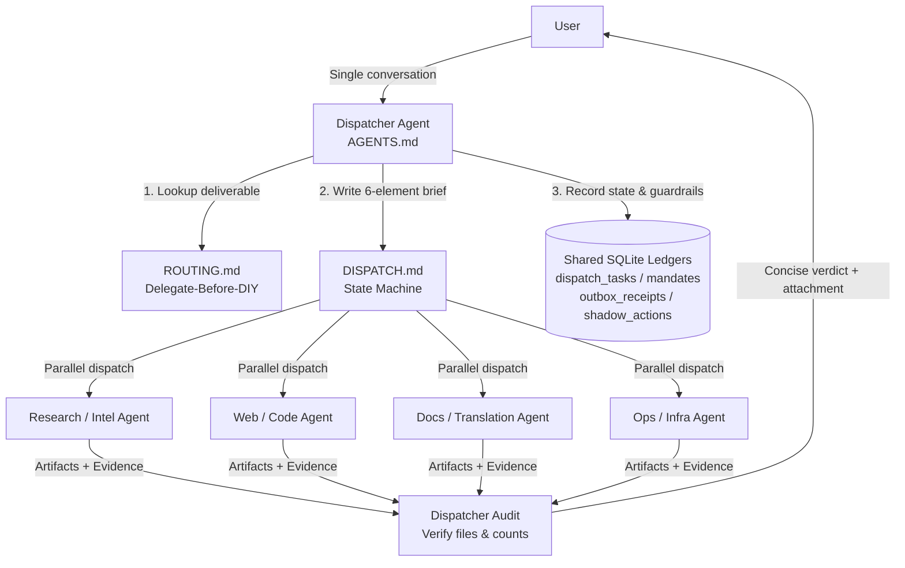

# MultiBot Dispatch Harness

**An Agent Dispatch Harness Framework Built on DeepSeek Harness's Official SuperAgent Concept — Purpose-Built for Always-On Multi-Bot Runtimes like OpenBot, Grok Bot, and OpenManusBot**

[简体中文](./README.zh-CN.md) | **English**

A battle-tested **PM / Dispatcher prompt architecture, audit-ledger SQL schema, and reusable skill kit** for multi-agent AI assistants — designed for **OpenBot**, **Grok Bot**, and **OpenManusBot**.

> **Core Premise: You only talk to ONE primary agent. The real bottleneck in multi-agent AI is human attention, not agent compute.**

---

## The Problem This Solves: Human Attention Scarcity

Adding more AI agents rarely saves time by itself — it usually creates **attention debt**:

- Switching between 5–15 specialist chats, repeating context, and manually passing files from one bot to another.
- Reading walls of tool-call narration and status updates while hunting for the single yes/no decision that actually needs you.
- Auditing whether a bot that said *"Done"* actually updated the file or database, and catching duplicate emails/posts on retries.

**This architecture establishes one strict human-agent contract:**

- **One Human → One Primary Agent (the Dispatcher)**: You never manage, brief, or chase specialist worker agents directly. One primary agent owns decomposition, delegation, retries, evidence auditing, and merging.
- **Protect Human Attention as the Scarcest Resource**: Workers run noisily in the background; the primary agent stays silent during execution, suppresses zero-change scheduled runs, delivers long data as attachments, and surfaces only **a 1-line verdict + 3–5 bullets** (or **one concrete decision with options**).

---

## Why It Fits OpenBot / Grok Bot / OpenManusBot Best

This framework is purpose-built for **always-on, multi-bot agent runtimes** like **OpenBot**, **Grok Bot**, and **OpenManusBot** — rather than one-off chat UIs or single-file coding copilots:

| Capability in Bot Runtimes | Why This Harness Is Essential |
|---|---|
| **Multiple persistent specialist bots** | Gives you one primary Dispatcher (`ROUTING.md` + `DISPATCH.md`) so you stop tab-hopping across 5–15 bots. |
| **Scheduled / background routines** | Adds **Shadow Mode** (`shadow_actions`) and silent no-update rules so automated runs never spam or misfire unattended. |
| **Real external tools (mail, IM, web, deploy, shell)** | Enforces **Mandates** (`mandates`) and **Write-Before-Send** (`outbox_receipts`) before irreversible actions. |
| **Shared local workspace & SQLite state** | Turns loose bot handoffs into auditable evidence (real files, row counts, and idempotent `UPSERT` ledgers). |

---

## Why This Pattern Works

Beyond protecting attention, most multi-agent setups fail in four predictable ways:

1. **The Coordinator does everything itself** ("this looks quick, let me just run a script") — burning context and breaking role boundaries.
2. **Silent duplicate sends or runaway automation** — scheduled agents send the same email/post twice or take unapproved external actions.
3. **Wall-of-text progress spam** — agents narrate every tool call and bury the one decision you actually need to make.
4. **Trusting "Done" claims without checking artifacts** — a worker claims success while the output file is empty or stale.

**MultiBot Dispatch Harness** solves all four with four lightweight building blocks:



---

## Repository Structure

```text
multibot-dispatch-harness/
├── README.md                         # English overview
├── README.zh-CN.md                   # Chinese overview (简体中文)
├── LICENSE                           # MIT License
├── prompts/
│   ├── en/
│   │   ├── AGENTS.md                 # Core Dispatcher rules & communication contract
│   │   ├── DISPATCH.md               # 6-element brief template & state machine
│   │   └── ROUTING.md                # Deliverable routing table & Never-DIY guardrails
│   └── zh-CN/
│       ├── AGENTS.md                 # 调度员核心工作规则与输出协议
│       ├── DISPATCH.md               # 六要素派活手册与状态机
│       └── ROUTING.md                # 产出物路由表与红线清单
├── schemas/
│   └── audit_tables.sql              # 4 SQLite tables (tasks, mandates, outbox, shadow)
├── skills/
│   ├── dispatcher-routing/
│   │   ├── SKILL.md                  # Routing, batching, retry & 3-number audit (EN)
│   │   └── SKILL.zh-CN.md            # 调度员派活路由技能 (ZH)
│   └── parallel-split/
│       ├── SKILL.md                  # Multi-instruction parallel splitting (EN)
│       └── SKILL.zh-CN.md            # 多指令并行拆分技能 (ZH)
└── adapters/
    ├── openbot.md                    # OpenBot setup guide (EN / ZH)
    ├── grok-bot.md                   # Grok Bot setup guide (EN / ZH)
    └── openmanus-bot.md              # OpenManusBot setup guide (EN / ZH)
```

---

## Core Design Principles

### 1. Delegate Before DIY (`ROUTING.md`)
- The Dispatcher's first move on any deliverable or ops request is checking `ROUTING.md` — not opening a terminal.
- Explicit **Never-DIY list** blocks the coordinator from quietly taking over scraping, coding, translation, report writing, or ops work.
- Only **3 exceptions** allow direct action: (a) documented worker failure/block with user fallback approval, (b) read-only local verification, (c) task decomposition, briefing, and final merge.

### 2. SuperAgent-Style Governance Ledgers (`schemas/audit_tables.sql`)
- **`dispatch_tasks`**: Single source of truth for delegated work (`draft → dispatched → in_progress → review → done / blocked / cancelled`), upserted by unique `task_key`.
- **`mandates`**: Tracks *who* authorized *what* scope and on what *basis* (`direct_request` / `followup_confirmed` only; inferred or rule-based actions remain candidates until confirmed). "Stop" immediately revokes active mandates.
- **`outbox_receipts`**: **Write-before-send** idempotency ledger (`dedupe_key`) for all irreversible outbound actions (messages, emails, posts, deployments, payments). Prevents duplicate sends on retries or cron runs.
- **`shadow_actions`**: Proactive or scheduled routines run in **shadow mode** first — logging *what they would have done* without executing — until the user inspects the log and promotes them to live.

### 3. Low-Attention Communication Contract (`AGENTS.md`)
- **Conclusion first** (one direct line, no filler or recap).
- **3–5 crisp numbered actions** with bold highlights only on numbers, deadlines, blockers, and decisions.
- **No progress narration** — speak only on completion, blockers, or decisions.
- **One decision at a time**, always with concrete options.
- **Files over text walls** — deliver tables and reports as attachments, keeping chat to a 1-line summary.

### 4. Evidence-Based Verification & Parallel Execution (`skills/`)
- Never accept a worker's "done" message at face value — inspect real files, timestamps, and database row counts.
- Merge multiple edits for the same deliverable into **one numbered change list** so workers finish in a single round.
- Automatically split multi-intent user messages into conflict-free parallel tracks (cross-agent first, then sub-tasks, then serial).

---

## Quick Start

1. **Copy the prompt trio** (`prompts/en/` or `prompts/zh-CN/`):
   - Place `AGENTS.md`, `DISPATCH.md`, and `ROUTING.md` in your Dispatcher agent's workspace root.
2. **Customize `ROUTING.md`**:
   - Replace the example worker roles with your actual specialist agents and their output directories/tables.
3. **Initialize the 4 SQLite tables**:
   - Run [`schemas/audit_tables.sql`](./schemas/audit_tables.sql) in your shared SQLite database (or OpenBot shared database).
4. **Install the 2 skills** (optional but recommended):
   - Load `skills/dispatcher-routing/` and `skills/parallel-split/` into your Dispatcher agent's skills directory.
5. **Apply platform-specific wiring**:
   - Follow the adapter guide for your runtime:
     - [OpenBot Adapter](./adapters/openbot.md)
     - [Grok Bot Adapter](./adapters/grok-bot.md)
     - [OpenManusBot Adapter](./adapters/openmanus-bot.md)

---

## Important Note on Security Boundaries

Audit tables (`mandates`, `outbox_receipts`, `shadow_actions`) provide **observability and idempotency**, not cryptographic enforcement. Real hard boundaries still come from tool-level permissions, confirmation gates, and workspace isolation. Always pair prompt governance with least-privilege tool access.

---

## License & Credits

[MIT](./LICENSE) © 2026 [@Muzileess290](https://github.com/Muzileess290) & **OpenBot** — free to use, adapt, and redistribute in personal, commercial, and open-source agent setups.
