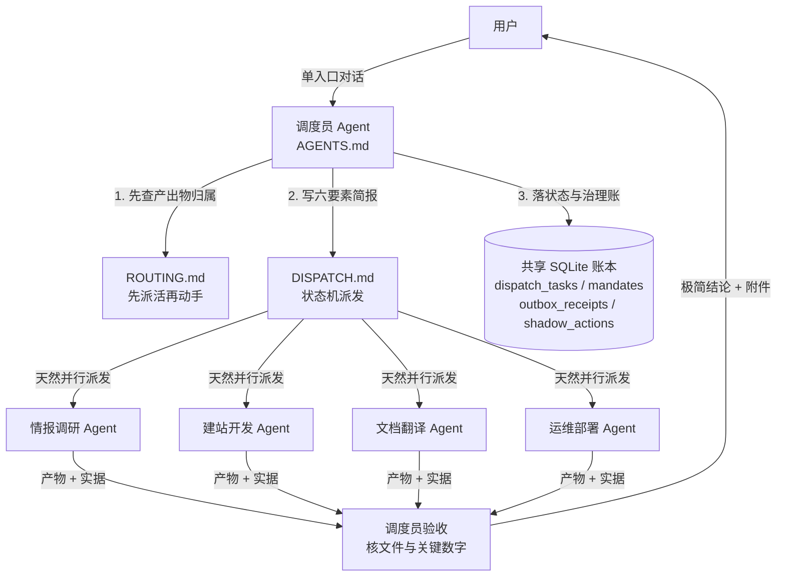

# MultiBot Dispatch Harness（多 Bot 派发 Harness 框架）

**基于 DeepSeek Harness 官方 SuperAgent 概念打造的 Agent 派发 Harness 框架**

**简体中文** | [English](./README.md)

一套经过真实多 Agent 日常生产打磨的 **调度员（PM / 交付负责人）提示词架构、审计账本 SQL 与可复用技能包**，面向 **OpenBot**、**Grok Bot** 与 **OpenManusBot** 开箱即用。

> **核心前提：人只需要跟一个主 Agent 对话。多 Agent 时代真正的瓶颈不是算力，而是人的注意力不够。**

---

## 这套模式真正解决什么问题：人的注意力不够

多 Agent 系统最容易走偏的地方，不是模型不够强，而是**把协调成本转嫁给了人**：

- 同时在七八个专职 Agent 窗口间来回切换、重复交代背景、手动搬运文件。
- 被满屏的进度播报和长篇总结淹没，反而找不到真正需要你拍板的那 1 个问题。
- 每次收到“已完成”还得自己去翻文件、核条数，或者担心定时任务把同一封邮件发两遍。

**这套架构确立一条清晰的协作关系：**

- **人 → 只跟主 Agent（调度员）对话**：用户永远只面对一个主入口，不需要直接指挥、催促或验收各个执行层 Agent。拆需求、按表派活、超时重派、核验收据与合并交付，全部由主 Agent 在背后消化。
- **把人的注意力当成最稀缺资源**：执行过程不刷进度，定时无新增直接静默，长清单和报告一律走附件，聊天里只给 **一句话结论 + 3–5 条精简清单**，需要拍板时**一次只问 1 个带选项的问题**。

---

## 为什么更适合 OpenBot / Grok Bot / OpenManusBot 这类 Bot 工具

这套框架并不是给“一次性问答网页”或“单文件写代码助手”设计的，而是专门针对 **OpenBot、Grok Bot、OpenManusBot** 这类**常驻、多角色、能真干活的 Bot 运行时**：

| Bot 工具的典型能力 | 为什么特别需要这套 Harness |
|---|---|
| **常驻多个专职 Bot** | 用单一主 Agent + `ROUTING.md` 接管拆活与派发，彻底告别在十几个 Bot 窗口间来回切。 |
| **定时巡检与后台自动运行** | 用 **影子账本（`shadow_actions`）** 和无新增静默机制，防止无人值守时刷屏或误触发。 |
| **具备真实外部执行权限（邮件/消息/浏览器/部署/运维）** | 用 **授权凭据（`mandates`）** 与 **外发先记账（`outbox_receipts`）** 兜住不可逆风险与重复外发。 |
| **拥有共享目录与结构化状态存储** | 把口头“已完成”变成可核验的真实文件、数据库行数与幂等状态机（`dispatch_tasks`）。 |

---

## 为什么这套模式能跑稳

在守住人的注意力之外，多 Agent 协作还有四个高频坑：

1. **调度员管不住手，自己开终端硬干** —— 觉得“这个很快”，结果把主会话上下文吃爆、职责边界全乱。
2. **外发重发或定时失控** —— 重试或定时任务把同一封邮件/消息发两遍，或未经批准直接外发。
3. **满屏进度播报与废话** —— 干活时不停汇报过程，真正需要用户拍板的 1 个问题被埋在长文里。
4. **盲信执行层“已完成”回执** —— 不看实际文件和数据库行数，直接把空文件或旧版本转交给用户。

**MultiBot Dispatch Harness** 用四块轻量组件把这四个坑一次填平：



---

## 仓库结构

```text
multibot-dispatch-harness/
├── README.md                         # 英文主说明
├── README.zh-CN.md                   # 中文完整说明
├── LICENSE                           # MIT 开源协议
├── prompts/
│   ├── zh-CN/
│   │   ├── AGENTS.md                 # 调度员主规则（说话规范、先派活、三账本）
│   │   ├── DISPATCH.md               # 六要素派活手册与任务状态机
│   │   └── ROUTING.md                # 产出物路由表与“绝对不做”红线模板
│   └── en/
│       ├── AGENTS.md                 # English Dispatcher core instructions
│       ├── DISPATCH.md               # English 6-element dispatch playbook
│       └── ROUTING.md                # English deliverable routing table
├── schemas/
│   └── audit_tables.sql              # 4 张 SQLite 治理表建表语句
├── skills/
│   ├── dispatcher-routing/
│   │   ├── SKILL.zh-CN.md            # 技能：调度员派活路由与验收
│   │   └── SKILL.md                  # Skill: Dispatcher Routing & Verification
│   └── parallel-split/
│       ├── SKILL.zh-CN.md            # 技能：多指令并行拆分
│       └── SKILL.md                  # Skill: Multi-Instruction Parallel Split
└── adapters/
    ├── openbot.md                    # OpenBot 接入指南（中英双语）
    ├── grok-bot.md                   # Grok Bot 接入指南（中英双语）
    └── openmanus-bot.md              # OpenManusBot 接入指南（中英双语）
```

---

## 四大核心机制

### 1. 先派活，再自己动手（`ROUTING.md`）
- 接到任何产出物或运维需求，**第一动作是查路由表**，表里有归属直接派，不自评“很快”就自己干。
- 明确列出 **“我绝对不做的清单”**（写爬虫、写正文、翻译、做前端、发布上线、运维等）。
- 仅留 **3 种例外**：① 执行层试过并报回卡住且经用户确认接手；② 纯本地只读核查；③ 拆活、写简报、汇总交付。

### 2. SuperAgent 式四张治理账本（`schemas/audit_tables.sql`）
- **`dispatch_tasks`（任务状态机）**：唯一状态写入处，按 `task_key` 覆盖写（`draft → dispatched → in_progress → review → done / blocked / cancelled`），防止重复行。
- **`mandates`（授权凭据）**：记清「谁批的、批了什么范围、依据是什么」。只认「本人直接要求 / 追问中明确要求」，规则放开或推断只当候选；用户说停立即作废。
- **`outbox_receipts`（外发收据，先写后发）**：任何不可逆对外动作（发消息、邮件、发帖、部署、付款）发出前先按 `dedupe_key` 记账，重跑查账防重复外发。
- **`shadow_actions`（影子账本）**：定时任务或主动行为前几次只记录「本来会做什么」，不真做不外发，等用户审过日志再放行。

### 3. 少占注意力的表达协议（`AGENTS.md`）
- **第一行直接给结论**（不超过 30 字），紧接 3–5 条精简编号清单。
- 干活过程不刷进度，有结果、需决策、做不下去时才开口。
- 信息不够时一次只问 **1 个具体问题并给选项**。
- 长清单和报告一律交附件，聊天正文只留一行结论。

### 4. 核实据验收与多指令并行（`skills/`）
- 不轻信执行层的“已完成”回执，直接核对实际文件与数据库行数；同一件事多项改动合并成一份编号变更清单一次发出。
- 一条消息含多条独立指令时，自动判依赖与写冲突，优先跨 Agent 真并行，再开同 Agent 子任务。

---

## 快速开始

1. **放入三件套提示词**：把 `prompts/zh-CN/`（或 `prompts/en/`）下的 `AGENTS.md`、`DISPATCH.md`、`ROUTING.md` 放到调度员 Agent 的工作目录根路径。
2. **按你的团队改 `ROUTING.md`**：把示例里的执行层 Agent 替换成你自己的专职 Agent 名称、输出目录和表名。
3. **初始化四张治理表**：在共享 SQLite 库中执行 [`schemas/audit_tables.sql`](./schemas/audit_tables.sql)。
4. **挂载两项技能（推荐）**：把 `skills/dispatcher-routing/` 与 `skills/parallel-split/` 装入调度员技能目录。
5. **按平台完成对接**：
   - [OpenBot 接入指南](./adapters/openbot.md)
   - [Grok Bot 接入指南](./adapters/grok-bot.md)
   - [OpenManusBot 接入指南](./adapters/openmanus-bot.md)

---

## 安全提醒

账本记录提供的是**可审计性与幂等防重**，拦不住越权执行。真正的硬边界来自工具权限、最小授权和外发人工确认，请务必把提示词治理与宿主权限隔离结合使用。

---

## 开源协议与署名

[MIT License](./LICENSE) © 2026 [@Muzileess290](https://github.com/Muzileess290) & **OpenBot** —— 可自由用于个人、商业及各类开源 Agent 项目。
